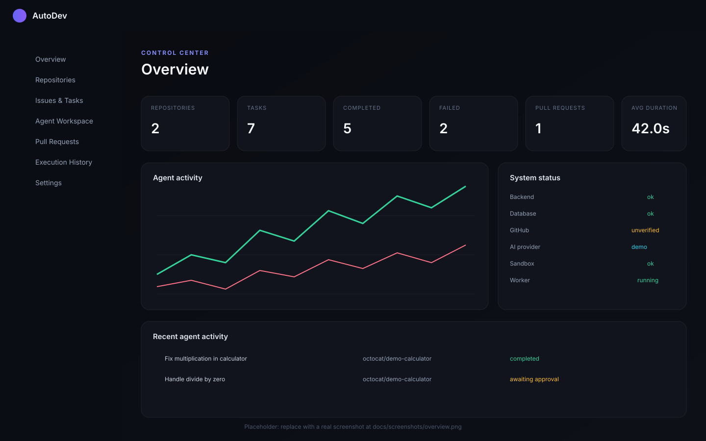
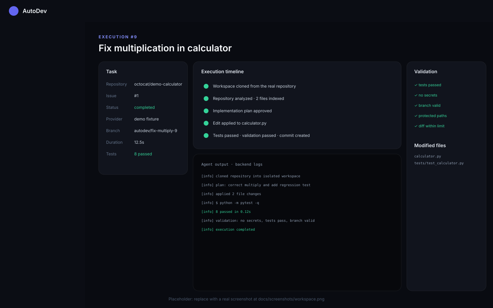
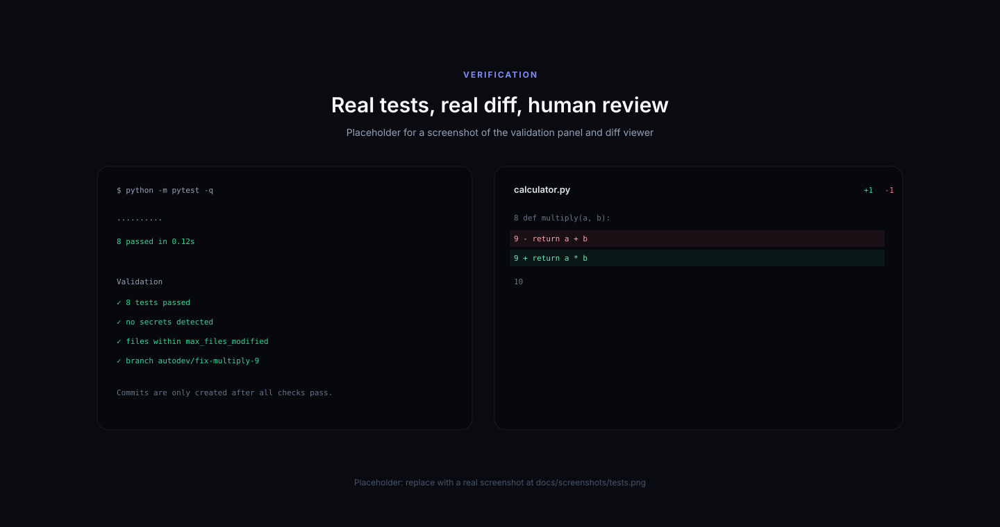
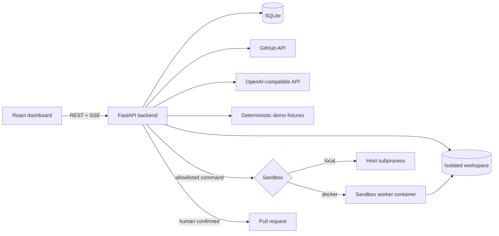
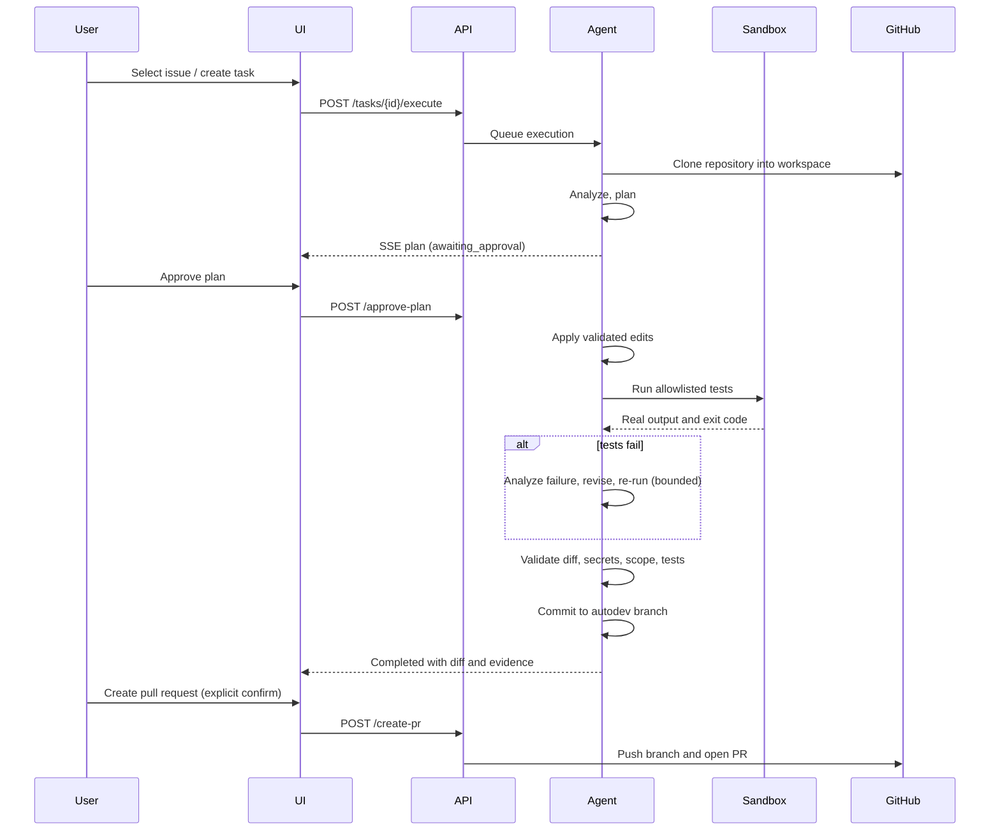

# AutoDev

**An autonomous AI coding agent with a human in the loop.** AutoDev turns GitHub issues or custom
development requests into real, tested, reviewable pull requests: it inspects a repository, plans a
change, edits an isolated workspace, runs the project's real tests, corrects failures, validates the
diff, commits to a feature branch and prepares a pull request for a human to approve.

The dashboard is a complete React control plane: repositories, issues, task queue, live execution
terminal, plan approval, test evidence, diff viewer, pull requests, audit history and runtime
settings.

> **Demo mode without credentials.** AutoDev runs immediately without a GitHub token or AI key. It
> then uses the bundled calculator repository and a **deterministic fixture provider**. Demo mode is
> labelled everywhere, no AI model is called, and no fixture output is presented as AI-generated.
> Cloning, file edits, pytest execution, failure correction, git commits, diffs and validation are
> real in demo mode. See [What is real](#what-is-real).

[](https://github.com/OWNER/autodev/actions/workflows/backend-ci.yml)
[](https://github.com/OWNER/autodev/actions/workflows/frontend-ci.yml)
[](https://github.com/OWNER/autodev/actions/workflows/docker-build.yml)

> Replace `OWNER/autodev` in the badge URLs after uploading the repository.

---

## Screenshots

These are checked-in placeholders. Replace them with real screenshots of your running instance
(`docs/screenshots/overview.png`, `workspace.png`, `tests.png`) when publishing.

| Dashboard | Agent workspace |
| --- | --- |
|  |  |



---

## What is real

| Capability | Behaviour |
| --- | --- |
| Repository connection | Real GitHub metadata through PyGithub with a PAT or GitHub App. No connection is faked. |
| Analysis | Real shallow clone into an isolated workspace; indexes languages, modules, entry points, tests, configs, dependencies and commands. Secret/build directories are excluded. |
| Planning & editing | Generated by the configured AI provider and schema-validated. Without a key, deterministic fixtures for the bundled calculator repository. |
| Tests | Real subprocess execution under an allowlist policy. Docker mode runs in a separate worker container. Output and pytest counts are parsed from the run. |
| Failure correction | Real loop: failing output is fed back, files are revised, tests re-run, every attempt is persisted. |
| Diff | Derived from the actual staged git diff, not generated prose. Split/unified viewer with `.patch` download. |
| Validation | Branch namespace, changed-file scope, protected paths, binary files, diff size, secret patterns and test results. Fails closed. |
| Commit & branch | Real commit on `autodev/<slug>-<id>` in the workspace. Main/base branches are never written. |
| Pull request | Real GitHub pull request only after human confirmation and only with a configured remote. Never auto-merged, approved or force-pushed. |
| History | Every execution, log, test attempt, diff and failure is stored in SQLite and never overwritten. |
| Dashboard metrics | Computed from persisted records. |
| Demo issues | Clearly flagged fixtures for the bundled repository. |

Demo mode does **not** simulate a GitHub connection, test result, diff or successful execution.

---

## Architecture





Deeper design notes: [docs/ARCHITECTURE.md](docs/ARCHITECTURE.md). API reference:
[docs/API.md](docs/API.md). Security model: [SECURITY.md](SECURITY.md).

---

## Stack

- **Frontend:** React 18, TypeScript, Vite, Tailwind CSS, React Router, Lucide, Recharts, custom LCS
  diff viewer.
- **Backend:** FastAPI, Pydantic v2, SQLAlchemy 2, SQLite, PyGithub, HTTPX, SSE.
- **Agent:** provider abstraction (OpenAI-compatible or deterministic demo), repository analyzer,
  planner, editor, test executor, failure analyzer, patch validator, git manager, PR manager.
- **Worker:** isolated FastAPI sandbox service (Docker mode).
- **Tooling:** pytest, Ruff, Vitest, Testing Library, ESLint, Docker Compose, GitHub Actions.

---

## Quick start (local)

Requirements: Python 3.12+, Node.js 20+ (tested on 24), git. Windows, macOS and Linux are supported.

### 1. Backend

```bash
# macOS / Linux
python -m venv backend/.venv
backend/.venv/bin/python -m pip install -r backend/requirements-dev.txt

# Windows PowerShell
python -m venv backend\.venv
backend\.venv\Scripts\python.exe -m pip install -r backend\requirements-dev.txt
```

Optional configuration:

```bash
cp .env.example .env
# edit .env if you have GitHub/AI credentials; demo mode needs none
```

Start the API from `backend`:

```bash
# macOS / Linux
cd backend
./.venv/bin/python -m uvicorn app.main:app --reload --host 127.0.0.1 --port 8000

# Windows PowerShell
cd backend
.\.venv\Scripts\python.exe -m uvicorn app.main:app --reload --host 127.0.0.1 --port 8000
```

The API is at `http://127.0.0.1:8000`, OpenAPI docs at `/docs`. On first start it creates the SQLite
schema, materialises the bundled calculator repository under `data/workspaces/_demo_source` and
seeds demo tasks.

### 2. Frontend

In a second terminal:

```bash
cd frontend
npm install
npm run dev
```

Open **http://127.0.0.1:5173**. Vite proxies `/api` to the backend, including the SSE stream.

### 3. Run the demo end to end

1. Open **Issues & Tasks** and select `octocat/demo-calculator (demo)`.
2. Pick the **Fix multiplication** fixture and choose **Use issue**, then **Create & run**.
3. Watch the **Agent Workspace** stream real logs and stage transitions.
4. With the default `REQUIRE_PLAN_APPROVAL=true`, review the plan and click **Approve plan**.
5. Review the real test output and changed files, then open **View generated diff**.
6. Preview the pull request draft. The bundled repository is local, so no GitHub PR is created; the
   draft is still generated from the validated diff. Connect a real repository to open PRs.

The expected demo result is a correct `multiply` implementation plus a regression test, `8 passed`
from pytest, validation passing and a real diff. The fixture provider is labelled **demo fixtures**
in the UI and logs.

### Production-ish local start

```bash
cd frontend && npm run build && cd ..
cd backend
./.venv/bin/python -m uvicorn app.main:app --host 127.0.0.1 --port 8000
```

FastAPI serves `frontend/dist` at `http://127.0.0.1:8000` when it exists.

---

## Configuration

Copy `.env.example` to `.env`. Secrets are read by the backend only; they are never sent to the
browser, stored in the database or written to logs.

| Variable | Default | Purpose |
| --- | --- | --- |
| `DATABASE_URL` | `sqlite:///./autodev.db` | SQLAlchemy database URL |
| `WORKSPACE_DIR` | `./data/workspaces` | Root for clones and demo source |
| `DEMO_REPO_DIR` | `./backend/demo_repo` | Bundled demo project |
| `AUTODEV_API_TOKEN` | empty | Require `Authorization: Bearer` on API routes |
| `CORS_ORIGINS` | localhost Vite origins | Allowed browser origins |
| `GITHUB_TOKEN` | empty | PAT with metadata read, contents read/write, issues read, PRs read/write |
| `GITHUB_APP_ID` / `GITHUB_APP_PRIVATE_KEY` / `GITHUB_APP_INSTALLATION_ID` | empty | GitHub App alternative |
| `GITHUB_API_URL` | `https://api.github.com` | GitHub Enterprise support |
| `AI_PROVIDER` | `auto` | `auto`, `openai` or `demo` |
| `AI_API_KEY` | empty | OpenAI-compatible key; absent ⇒ demo fixtures |
| `AI_BASE_URL` / `AI_MODEL` | OpenAI defaults | Any compatible endpoint/model |
| `AGENT_MAX_CORRECTION_ATTEMPTS` | `2` | Failure-correction cap (0–5) |
| `AGENT_EXECUTION_TIMEOUT` | `600` | Whole execution timeout |
| `AGENT_TEST_TIMEOUT` | `180` | Per test command timeout |
| `AGENT_MAX_FILES_MODIFIED` | `10` | Edit scope limit |
| `AGENT_MAX_CONCURRENT_TASKS` | `2` | Worker concurrency |
| `REQUIRE_PLAN_APPROVAL` | `true` | Pause for human plan approval |
| `REQUIRE_PR_APPROVAL` | `true` | Require explicit confirm to create PRs |
| `ALLOWED_COMMANDS` | `python,python3,pytest,npm,node,yarn,pnpm,ruff,tsc,go,cargo` | Sandbox executable allowlist |
| `SANDBOX_MODE` | `local` | `local` or `docker` |
| `SANDBOX_URL` | `http://127.0.0.1:8010` | Worker base URL in Docker mode |
| `SANDBOX_TOKEN` | dev default | Shared worker authentication token |

Runtime agent/testing settings can also be changed in the **Settings** page. Server-side validation
enforces ranges, bare command names and branch syntax. Environment credentials require a restart.

### AI provider

Set `AI_API_KEY` (and optionally `AI_BASE_URL`, `AI_MODEL`) to use a real OpenAI-compatible model.
`AI_PROVIDER=auto` uses the model when a key exists and otherwise runs deterministic demo fixtures.
The frontend never receives the key. Repository and issue content is wrapped in untrusted-data
delimiters; model output is schema-validated before it can influence files.

### GitHub integration

Create a fine-grained PAT limited to the repositories AutoDev may use, with:

- Metadata: read
- Contents: read and write
- Issues: read
- Pull requests: read and write

Set `GITHUB_TOKEN` and restart. Alternatively configure a GitHub App with the same repository
permissions and set `GITHUB_APP_ID`, `GITHUB_APP_PRIVATE_KEY` and `GITHUB_APP_INSTALLATION_ID`.
Then connect a repository explicitly on the **Repositories** page with `owner/name`.

AutoDev checks credentials on the system status endpoint: **configured** is not reported as
**verified** unless GitHub authentication succeeds.

---

## Docker

The Compose stack runs three services and an isolated workspace volume:

```bash
cp .env.example .env          # optional: add GitHub/AI credentials and tokens
docker compose up --build
```

Open **http://localhost:8080**.

- `frontend` — nginx serving the built SPA and proxying `/api` (SSE buffering disabled).
- `backend` — FastAPI on an internal network; persists `/data` and shares `/workspaces`.
- `worker` — sandbox-only container on an `internal: true` network, non-root UID 10001, read-only
  root filesystem, all capabilities dropped, memory/CPU/PID limits.

Set a unique `SANDBOX_TOKEN` in `.env` before any shared deployment. The worker is not published to
the host. `docker compose down` keeps named volumes; `docker compose down -v` **deletes** the
database, workspaces and history.

Compose sets `SANDBOX_MODE=docker`, so tests execute in the worker. The backend image includes git;
the worker includes Python, pytest, Node.js and npm. Extend `worker/Dockerfile` for other runtimes.

---

## Tests and checks

Verified in this working tree on Windows with Python 3.12.1, Node 24.18.1, npm 10.8.3:

```bash
cd backend && ./.venv/Scripts/python.exe -m pytest -q
# 36 passed

cd backend && ./.venv/Scripts/python.exe -m ruff check .
# All checks passed

cd frontend && npm run lint
# no warnings

cd frontend && npm run typecheck
# no errors

cd frontend && npm test
# 5 test files, 12 tests passed

cd frontend && npm run build
# built successfully
```

Backend coverage includes the full demo pipeline (real clone, edit, pytest, diff, branch), failure
correction, correction-cap failure, plan approval, cancellation, API contracts, path traversal,
command allowlist, secret redaction and scanning, prompt wrapping, patch validation and mocked
GitHub integration. Frontend tests cover formatting, diff rendering, the Overview dashboard, task
creation from an issue and the workspace (detail, diff modal, PR draft gating).

CI workflows: backend lint/test, frontend lint/typecheck/test/build, container builds with Compose
validation, and CodeQL security analysis. See `.github/workflows/`.

---

## Project structure

```text
.
├── backend/
│   ├── app/
│   │   ├── agent/              # orchestrator, analysis, planning, editing, tests, validation
│   │   ├── api/routes/         # REST + SSE
│   │   ├── core/               # config, security, errors, redaction, files
│   │   ├── database/           # SQLAlchemy session and schema
│   │   ├── integrations/github/# PAT / GitHub App service
│   │   ├── models/ schemas/    # persistence and API contracts
│   │   ├── services/           # demo seed, settings, execution serialization
│   │   └── main.py
│   ├── demo_repo/              # real calculator with a bug and pytest suite
│   ├── tests/                  # 36 pytest tests
│   ├── Dockerfile
│   └── requirements*.txt
├── frontend/
│   ├── src/
│   │   ├── components/         # UI, diff viewer, terminal, timeline, chart
│   │   ├── pages/              # Overview, Repositories, Tasks, Workspace, PRs, History, Settings
│   │   ├── hooks/ services/    # API client, SSE, queries
│   │   └── test/               # Vitest setup
│   ├── Dockerfile
│   └── nginx.conf
├── worker/                     # isolated sandbox HTTP service
├── docs/                       # architecture, API, screenshot placeholders
├── .github/workflows/          # four CI/security workflows
├── docker-compose.yml
├── .env.example
├── SECURITY.md
└── LICENSE
```

---

## API summary

Full reference with examples: [docs/API.md](docs/API.md).

- `GET /api/health`, `/api/system/info`, `/api/system/status`, `/api/dashboard/stats`
- `GET|POST /api/repositories`, `/analyze`, `/refresh`, `/issues`
- `GET|POST /api/tasks`, `POST /api/tasks/{id}/execute`
- `GET /api/executions`, `/logs`, `/stream`, `/diff`, `/diff/patch`, `/pr-draft`
- `POST /api/executions/{id}/approve-plan`, `/cancel`, `/retry`, `/create-pr`
- `GET /api/pull-requests`, `GET|PUT /api/settings`

SSE streams `log`, `state` and `end` events. Logs are persisted and replayable.

---

## Safety model

- Tokens remain server-side; only booleans and masked configuration reach the UI.
- `autodev/` feature branches only; no direct base-branch pushes, no force-push, no auto-merge.
- Plan approval and pull request confirmation are independent human gates.
- Path traversal, symlink escapes, protected files, binary files and oversized diffs are blocked.
- Commands use a bare-executable allowlist with no shell metacharacters; shell interpreters and
  inline eval are rejected.
- Tests run with a scrubbed environment, timeouts, process-tree termination and resource limits.
- Diffs are scanned for secrets before commit and PR creation; logs redact known token formats.
- Prompt injection defenses wrap repository content as untrusted data and validate structured output.
- Optional API bearer token; security headers; CORS allowlist.

Read [SECURITY.md](SECURITY.md) before deploying. **`SANDBOX_MODE=local` is not a security boundary
for untrusted code** — use Docker mode.

---

## Limitations

- The in-process worker is single-backend and does not survive restarts; interrupted executions are
  marked failed and can be retried. Existing logs/diffs are retained.
- SQLite fits a single backend instance, not horizontal scaling.
- The worker does not install repository dependencies; extend the image or pre-bake dependencies.
- No inbound GitHub webhooks; connections and issue reads are explicit.
- Demo fixtures cover the bundled calculator tasks only. Other tasks without an AI key fail
  honestly rather than inventing code.
- Pull requests require a real remote; the local demo repository can only preview a draft.
- The Docker stack was configuration-validated; building all images takes several minutes.

---

## License

MIT — see [LICENSE](LICENSE).

---
