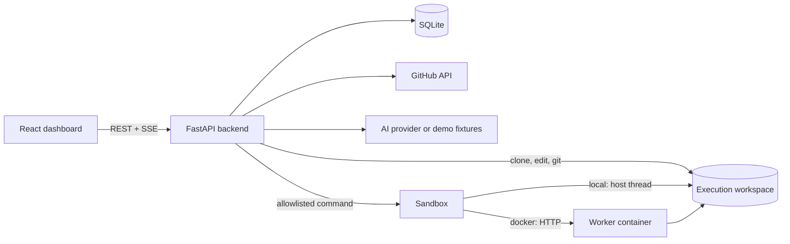
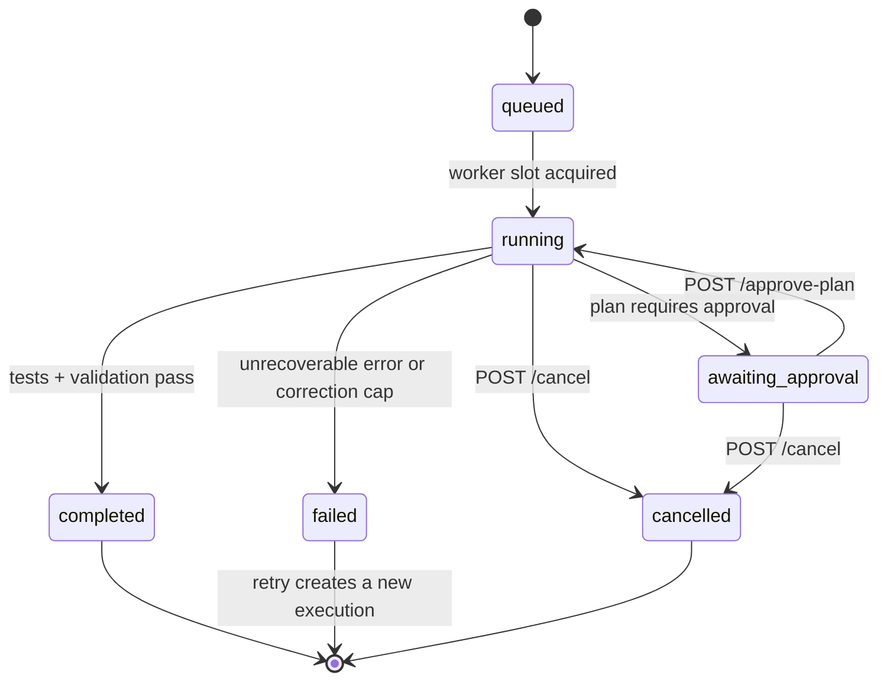

# Architecture

AutoDev is a monorepo with three runtimes and one shared workspace contract.

## Components

### Backend (`backend/app`)

| Package | Responsibility |
| --- | --- |
| `api/routes` | REST endpoints, SSE stream, dashboard aggregates, system status |
| `agent/orchestrator.py` | Execution state machine, concurrency, cancellation, correction loop |
| `agent/repository_analyzer.py` | Real clone indexing: languages, modules, tests, entry points, commands |
| `agent/planning_engine.py` | Plan generation and schema validation |
| `agent/code_generator.py` / `code_editor.py` | Structured edit application with path and size limits |
| `agent/test_executor.py` | Command policy, local/Docker sandboxes, pytest output parsing |
| `agent/patch_validator.py` | Diff, branch, protected path, secret and test-result validation |
| `agent/pull_request_manager.py` | Human-confirmed branch push and pull request creation |
| `agent/ai` | Provider abstraction: OpenAI-compatible client and deterministic demo provider |
| `integrations/github` | PyGithub service supporting PAT and GitHub App auth |
| `services` | Demo seed, settings validation, execution serialization and actions |
| `models` / `schemas` | SQLAlchemy persistence and Pydantic contracts |

### Frontend (`frontend/src`)

React 18, TypeScript, Vite, Tailwind, React Router, Recharts and Lucide. The API client is typed and
keeps optional bearer tokens client-side. Execution events arrive over `EventSource`; polling is a
fallback while an execution is active. The diff viewer computes line diffs locally (LCS), with split
and unified modes; no CDN or editor service is required.

### Sandbox worker (`worker/`)

An internal-only FastAPI service. It accepts `{args, cwd, timeout}`, authenticates with
`X-Sandbox-Token`, confines `cwd` to `WORKSPACES_ROOT`, re-validates the executable allowlist, scrubs
the environment, runs without a shell and kills the process group on timeout. Docker Compose runs it
as UID 10001 with a read-only root filesystem, dropped capabilities and an internal network.

## Execution state machine

Stages are recorded as timeline entries: clone, analyze, plan, approved, edit, test, correct,
validate, commit, pull request. Logs are persisted per stage and also published on an in-process
event bus for SSE.

## Data model

- `Repository` — connected GitHub metadata and the latest analysis JSON.
- `DevelopmentTask` — issue-linked or custom work item.
- `AgentExecution` — status, stage, plan, validation report, branch, summary, token usage, errors.
- `ExecutionLog`, `FileChange`, `TestExecution` — the audit trail for each execution.
- `PullRequest` — draft and created pull request metadata.
- `AppSetting` — validated runtime overrides of environment defaults.

Retrying copies a task into a new execution; history is append-only and never overwritten.

## Failure correction

After each test run the failure analyzer extracts failing test names and relevant output. The code
generator receives the failure context and proposes a focused revision. The loop stops when tests
pass, the corrected attempt cap is reached, the execution timeout fires or the user cancels. Every
attempt is persisted, including failing output.

## Concurrency and cancellation

The orchestrator bounds active executions with `AGENT_MAX_CONCURRENT_TASKS` and keeps cancellation
tokens per execution. `POST /cancel` sets the token; the pipeline checks it between stages and the
sandbox terminates running processes. A backend restart marks queued/running/awaiting-approval
executions as failed and preserves their logs.

## Security boundaries

See [SECURITY.md](../SECURITY.md). The backend owns all credentials, the workspace is the only
writable surface, and the model has no direct tool access — its structured output is validated and
applied by deterministic code.
